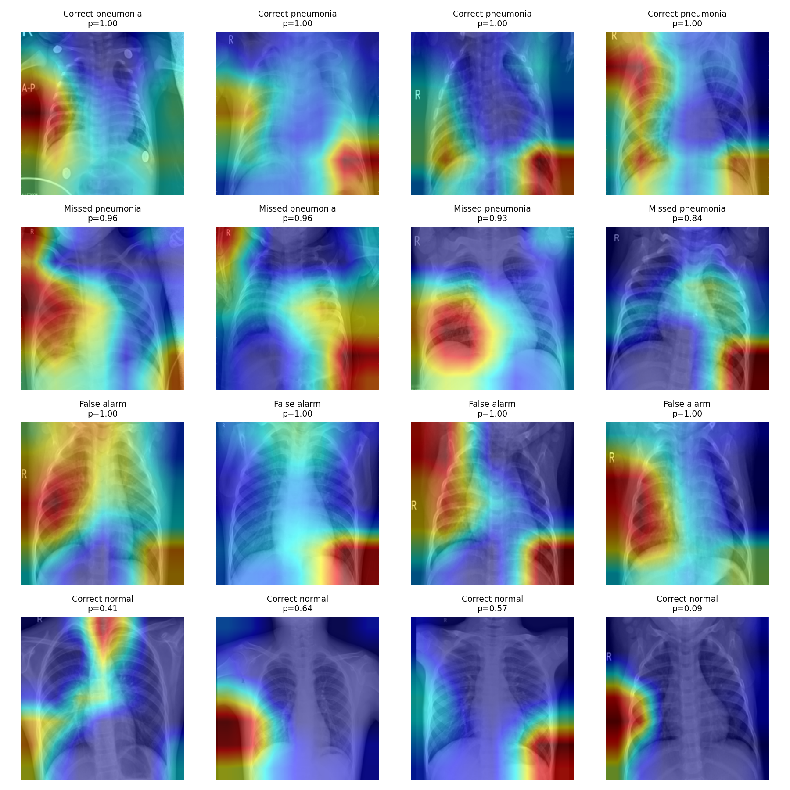

# PneumoScan: Chest X-ray Pneumonia Detection

A ResNet-18 fine-tuned to detect pneumonia from pediatric chest X-rays, tuned so it rarely misses a sick patient, with Grad-CAM heatmaps that show where in the lungs the model is looking. Includes a FastAPI inference server and a React web app.

> **Learning project, not a medical device.** Do not use it for diagnosis or treatment decisions.

---

## Highlights

- Fine-tuned a pretrained **ResNet-18** on 5,800+ chest X-rays with **class-weighted loss** to handle the roughly 3:1 pneumonia-to-normal imbalance.
- Chose the decision threshold on a **validation split** for a 98% recall target, instead of defaulting to 0.5, because missing pneumonia is the expensive mistake.
- Evaluated on the official test set **once**, so the reported numbers were never used to make decisions.
- Added **Grad-CAM** explainability and a border-attention check to look for shortcut learning.
- Built a **full-stack app**: FastAPI inference API plus a React interface with drag-and-drop upload, probability gauge and side-by-side heatmap.

## Results

Measured once on the official test set (624 images: 234 normal, 390 pneumonia), using a decision threshold of **0.9861** chosen on validation data.

| Metric | Value |
|---|---|
| Recall | **98.97%** (386 of 390 pneumonia cases caught) |
| Precision | **83.55%** |
| ROC-AUC | **0.9576** |

**Confusion matrix (test set)**

| | Predicted normal | Predicted pneumonia |
|---|---|---|
| **Actually normal** | 158 | 76 |
| **Actually pneumonia** | 4 | 386 |

**Baseline vs fine-tuned model (ROC-AUC)**

| Model | Validation | Test |
|---|---|---|
| Baseline (frozen ResNet-18, only final layer trained) | 0.9873 | 0.9583 |
| Fine-tuned ResNet-18 (all layers) | 0.9997 | 0.9576 |

On the test set the two models are effectively tied in ROC-AUC. The value of this project is the recall-tuned threshold, the careful evaluation and the explainability, not a large AUC gain.

## Explainability (Grad-CAM)



Heatmaps for correct pneumonia, missed pneumonia, false alarm and correct normal predictions. To check for shortcut learning, I measured how much of the heatmap falls in the outer 15% border of the image (which covers about 51% of the image area):

| Group | Border share of attention |
|---|---|
| Correct pneumonia | 0.53 |
| Missed pneumonia | 0.49 |
| False alarm | 0.51 |

These values match the border's share of the image area, so there is no sign that the model leans on image edges. Grad-CAM at this resolution is coarse, though, and cannot rule out every shortcut, such as small text markers.

## Tech stack

- **ML:** Python, PyTorch, torchvision, scikit-learn, pytorch-grad-cam
- **Backend:** FastAPI, Uvicorn
- **Frontend:** React.js, Vite, JavaScript, HTML5, CSS3, Canvas API
- **Training:** Kaggle notebooks (free GPU)

## Project structure

```
pneumoscan/
  backend/        FastAPI server, model weights (best_model.pt), threshold.json
  frontend/       React + Vite web app
  notebooks/      pneumoscan.ipynb (training and evaluation)
  assets/         images used in this README
  requirements.txt
  README.md
```

## How it works

1. **Data:** [Chest X-Ray Images (Pneumonia)](https://www.kaggle.com/datasets/paultimothymooney/chest-xray-pneumonia) on Kaggle. The official validation folder has only 16 images, so I merged it into train and made my own stratified 15% validation split.
2. **Preprocessing:** resize to 224x224, grayscale to 3 channels, ImageNet normalization. Augmentation on training data only: small rotations, crops and brightness changes.
3. **Baseline:** frozen ResNet-18 with only the final layer trained.
4. **Fine-tuning:** all layers unfrozen, AdamW at a learning rate of 1e-4, class-weighted cross-entropy, best checkpoint chosen by validation ROC-AUC.
5. **Threshold:** picked on the validation set to reach 98% recall (threshold 0.9861).
6. **Evaluation:** official test set run once. Recall, precision, ROC-AUC and confusion matrix reported.
7. **Explanation:** Grad-CAM on the last convolutional block, plus the border-attention check.

## Run it locally

### 1. Backend

```bash
python -m venv venv
venv\Scripts\activate            # Mac/Linux: source venv/bin/activate
pip install -r requirements.txt
cd backend
uvicorn server:app --reload
```

The API runs at `http://localhost:8000`. Interactive docs are at `http://localhost:8000/docs`.

`POST /predict` takes an image file and returns:

```json
{ "label": "PNEUMONIA", "probability": 0.99, "heatmap": "<base64 PNG>" }
```

### 2. Frontend

```bash
cd frontend
npm install
npm run dev
```

Open `http://localhost:5173`. To use a hosted backend, create `frontend/.env` with `VITE_API_URL=https://your-backend/predict`.

### 3. Retrain (optional)

Open `notebooks/pneumoscan.ipynb` in a Kaggle notebook with the dataset attached and the GPU turned on.

## Limitations

- Trained on **pediatric** chest X-rays from a **single source**, so results may not carry over to adults or other hospitals.
- The high-recall threshold causes **false alarms**: 76 healthy scans were flagged in testing (precision 83.55%).
- **Validation scores (0.9997 ROC-AUC) were much higher than test scores (0.9576).** The dataset has several images per child, and a random split can put the same child in both train and validation. The test numbers are the realistic ones.
- Grad-CAM heatmaps are coarse and are not proof that the model reasons like a clinician.
- This is an educational project and **not a medical device**.

## Future work

- Patient-level splits to remove validation leakage.
- Test on external datasets and adult X-rays.
- Probability calibration and a comparison with other backbones.
- Host the demo on Hugging Face Spaces.

## Acknowledgements

Dataset by Paul Mooney on Kaggle, based on the data from Kermany et al., "Identifying Medical Diagnoses and Treatable Diseases by Image-Based Deep Learning", Cell, 2018. Please check the dataset's license on Kaggle before redistributing any images.

## Author

Sushmitha Rajmohan
